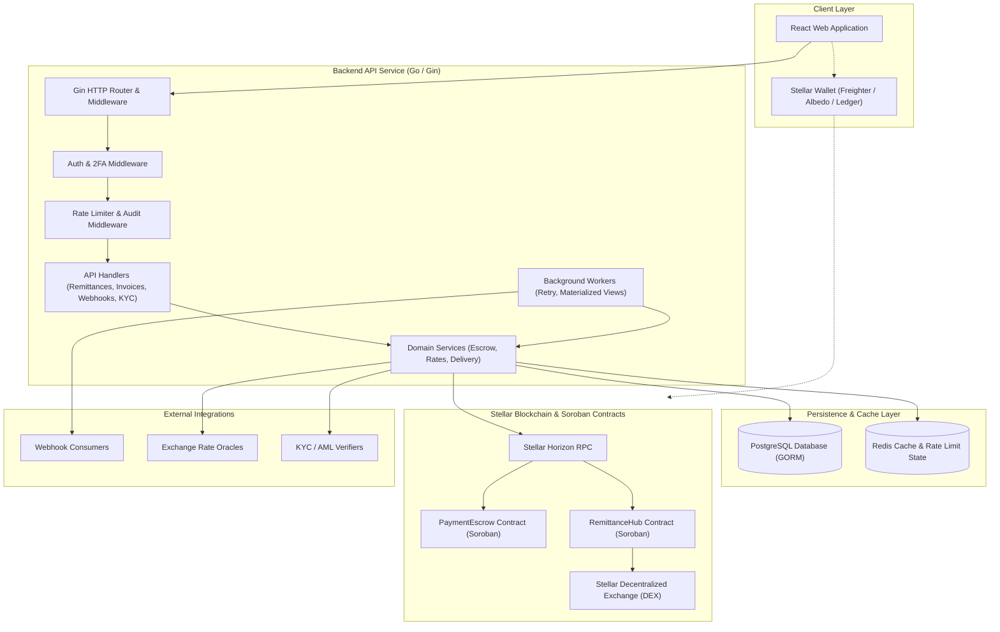
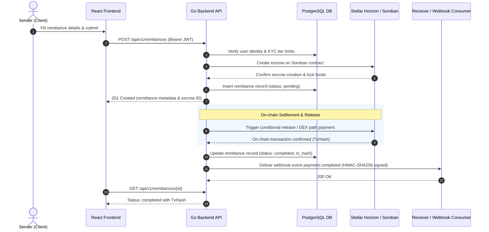
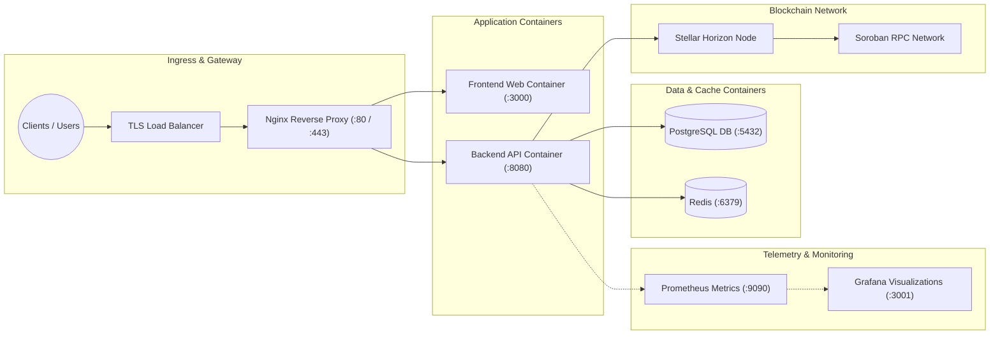

# Gpay-Remit Architecture

## Overview

Gpay-Remit is a modern, high-performance platform for cross-border payments and instant remittances built on the Stellar network and Soroban smart contracts.

The platform combines an off-chain API engine for fast compliance, user management, and transaction orchestration with trustless on-chain Soroban escrow contracts and Stellar DEX settlement.

---

## 1. System Architecture

---

## 2. Core Architecture Layers

### 2.1 Smart Contract Layer (Soroban)
- **Technology**: Rust with Soroban SDK.
- **Contracts**:
  - `PaymentEscrowContract`: Enforces conditional escrow deposits, multi-party approvals, timelocks, and atomic releases/refunds.
  - `RemittanceHubContract`: Handles cross-border routing, fee distribution, and currency exchange via Stellar DEX payment paths.
- **Key Capabilities**:
  - Trustless escrow holds without custodial intermediary risk.
  - Multi-asset settlements (USDC, XLM, EURC, etc.).
  - Deterministic state machine with ledger-anchored event logs.

### 2.2 Backend API Layer (Go)
- **Technology**: Go 1.25+ with Gin web framework.
- **Key Modules**:
  - `handlers/`: RESTful JSON endpoints for authentication, remittances, invoices, webhooks, and analytics.
  - `middleware/`: Structured logging, TLS termination, CORS, CSRF, JWT validation, rate limiting, and security headers.
  - `services/`: Business logic for transaction orchestration, Stellar Horizon client interactions, and webhook delivery.
  - `workers/`: Background workers for scheduled retries, cache refreshes, and dead-letter queue processing.

### 2.3 Frontend Layer (React)
- **Technology**: React 18, React Router, Stellar SDK, and Freighter API.
- **Key Features**:
  - Interactive remittance submission and status tracking.
  - Invoice viewing, generation, and payments.
  - Multi-wallet connection (Freighter, Albedo, Ledger).
  - TypeScript contract definitions synchronized with the backend OpenAPI schema.

### 2.4 Storage & Cache Layer
- **PostgreSQL**: Stores relational user models, invoices, audit trails, and webhook logs with GORM migrations.
- **Redis**: Fast key-value store for rate limiting tokens, exchange rate caching, and distributed worker locks.

---

## 3. Data Flow Architecture

The diagram below details the end-to-end data flow when a user initiates a cross-border remittance:

---

## 4. Deployment Topology

The production and local deployment topologies leverage containerized microservices managed via Docker Compose or Kubernetes:

---

## 5. Security Architecture

1. **Authentication & Authorization**: High-entropy JWT tokens with short TTLs and refresh token rotation, backed by optional TOTP two-factor authentication (2FA).
2. **HMAC Webhook Signatures**: All outgoing webhook deliveries include an `X-Webhook-Signature` HMAC-SHA256 digest and `X-Webhook-Timestamp` header to guard against spoofing and replay attacks.
3. **Database Security**: Prepared statements via GORM to eliminate SQL injections; encrypted sensitive credentials using AES-GCM-256.
4. **Blockchain Integrity**: Soroban smart contracts enforce strict caller authorization (`require_auth`) and reentrancy protections.
